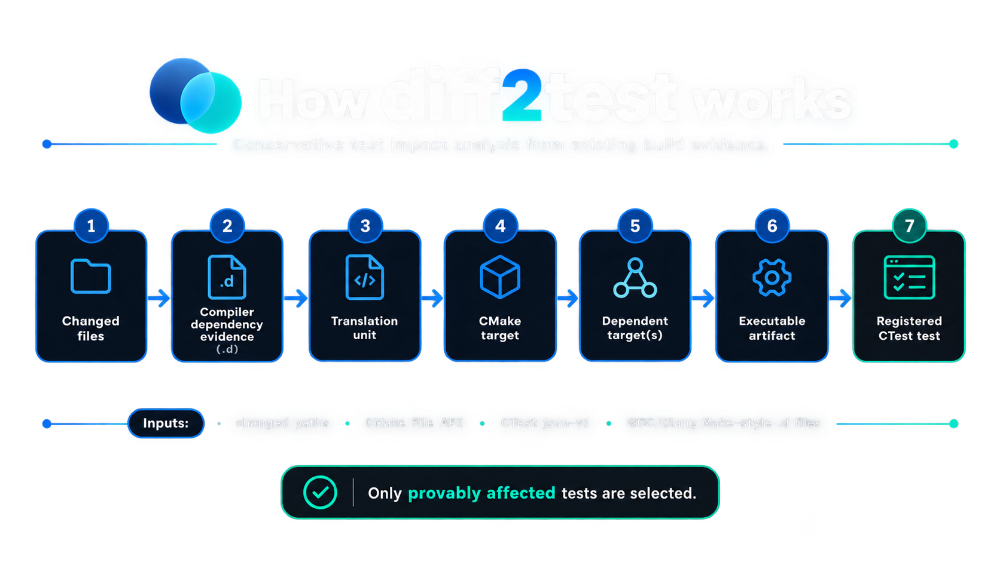
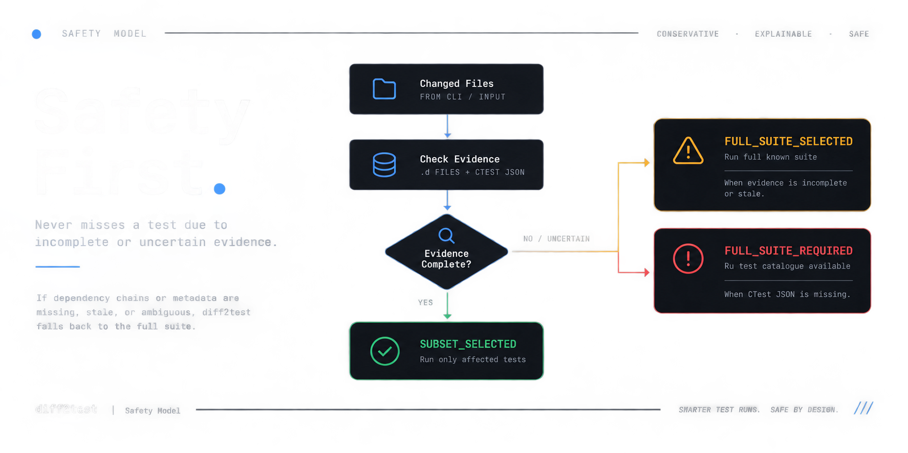

<div align="center">

# ImpactTrace


<br />

[](https://github.com/Aryanxp1/impact-trace/actions/workflows/ci.yml)


Select only the tests your build evidence can actually justify — and widen safely when that evidence is incomplete.

**Maintained by Aryan Vishwakarma · High-Performance C++20 Test Impact Analysis**

[Quick start](#quick-start) · [How it works](#how-it-works) · [C++ Engineering Highlights](#key-technical-features-c20-engineering) · [Safety model](#safety-model) · [Verification](#verification) · [Docs](#documentation)

</div>

---

## Why impact-trace?

Large C++ codebases face a major productivity bottleneck in continuous integration (CI):

- **Run everything** — 100% safe, but wastes immense compute and developer turnaround time on large monolithic builds.
- **Guess what changed** — fast, but naive diff-matching can silently skip tests and leak critical regressions into production.

`impact-trace` solves this with a conservative, evidence-driven test-impact selection model:

> **A test is omitted only when verifiable compiler and build dependency evidence proves it is unaffected.**

It connects changed source files directly to translation units, CMake target dependencies, and CTest test executables. If dependency evidence is incomplete, stale, malformed, or ambiguous, the selection safely widens to the entire test suite.

---

## Key Technical Features (C++20 Engineering)

- **Pure C++20 Standard Library (Zero Third-Party Dependencies):** Built without Boost, LLVM, or external libraries. The entire runtime engine is contained within a high-performance, single-file translation unit (`impact_trace.cpp`).
- **Custom Recursive-Descent JSON Parser:** Implements a strict JSON parser with UTF-8 verification, surrogate-pair decoding, duplicate-key rejection, exact byte/line/column diagnostic offsets, and recursive depth bounds.
- **Compiler Dependency File Scanner:** Custom tokenizer and parser for GCC/Clang Make-style `.d` dependency rules supporting line continuations, escaping, and deterministic deduplication.
- **DAG & Reverse Dependency Propagation:** Ingests CMake File API codemodel v2 to build an in-memory directed target dependency graph, computing reverse reachability sets to identify all indirectly affected downstream executables.
- **Deterministic Timestamp Staleness Auditing:** Inspects prerequisite file modification times against `.d` artifacts to detect stale build metadata before trusting impact conclusions.
- **Fail-Safe Conservative Contract:** Guarantees zero false negatives: any missing, unmapped, ambiguous, or stale build evidence automatically falls back to full test suite execution (`FULL_SUITE_SELECTED` / `FULL_SUITE_REQUIRED`).
- **Comprehensive Verification Suite:** Tested across 7 dedicated test suites covering JSON grammar edge cases, graph cycles/diamonds, stress testing up to 10,000 prerequisites, and cross-platform path normalization.

---

### Runtime Non-Invocative Architecture

`impact-trace` does **not** run tests and does **not** launch Git, CMake, CTest, a compiler, Python, a shell, a network service, or child processes at runtime. It operates as a pure data-pipeline consumer of existing build metadata.

---

## How it works

<p align="center">
  
</p>

```text
changed path
    ↓
compiler dependency evidence (.d)
    ↓
translation unit
    ↓
CMake target
    ↓
dependent target(s)
    ↓
executable artifact
    ↓
registered CTest test
```

The supported analysis combines four pre-generated inputs:

| Evidence | Purpose |
|---|---|
| changed paths | what the caller says changed |
| CMake File API codemodel v2 | sources, targets, artifacts, target dependencies |
| GCC/Clang Make-style `.d` files | file/header → translation-unit dependency evidence |
| CTest `json-v1` catalogue | registered tests and their command executables |

For every selected test, `--explain` can show a concrete evidence chain from the changed path to the registered test.

---

## Quick start

> **impact-trace never runs Git, CMake, or CTest; it consumes changed paths and metadata those tools already produced.**

For the conventional `build/` layout, generate the catalogue and dependency-file list externally, then compose changed paths through stdin:

```bash
ctest --test-dir build --show-only=json-v1 > build/ctest-info.json
find build -type f -name '*.o.d' -printf '%P\n' | sort > build/deps.txt
git diff --name-only HEAD~1 | ./build/impact-trace analyze .
```

The shell launches `git`, `ctest`, and `find`; `impact-trace` launches nothing. The shorthand defaults to `./build`, stdin, `build/.cmake/api/v1/reply`, `build/ctest-info.json`, and `build/deps.txt`. Every default has an explicit override.


> **impact-trace never runs Git, CMake, or CTest; it consumes changed paths and metadata those tools already produced.**

### 1. Build `impact-trace`

```bash
cmake -S . -B build -DCMAKE_BUILD_TYPE=Release -DBUILD_TESTING=OFF
cmake --build build
```

The executable is produced at:

```text
build/impact-trace
```

### 2. Generate metadata externally

These commands are part of the caller/developer workflow. They are **not** executed by `impact-trace`.

```bash
cmake -E make_directory build/.cmake/api/v1/query
cmake -E touch build/.cmake/api/v1/query/codemodel-v2
cmake -S . -B build -DCMAKE_BUILD_TYPE=Release
cmake --build build
ctest --test-dir build --show-only=json-v1 > build/ctest-info.json
find build -type f -name '*.o.d' -printf '%P\n' | sort > build/deps.txt
```

The `.d` list is generated externally because `impact-trace` deliberately does not recursively accept every `.d` file under a build tree. The analysis engine still validates each listed dependency file against known CMake targets and translation units.

### 3. Analyze changed paths

Preferred common case:

```bash
git diff --name-only HEAD~1 | ./build/impact-trace analyze .
```

With a conventional `build/` directory, that shorthand means:

```text
project root   = .
build root     = ./build
changed paths  = stdin
CMake reply    = ./build/.cmake/api/v1/reply
CTest catalogue= ./build/ctest-info.json
dependency list= ./build/deps.txt
```

The shell launches `git` and creates the pipe. `impact-trace` only reads stdin and existing files.

Explicit overrides remain available:

```bash
# Explicit build directory
git diff --name-only HEAD~1 | ./build/impact-trace analyze . --build build-debug

# Explicit changed-file source
./build/impact-trace analyze . --changed-files changed.txt

# Fully explicit legacy/advanced form
./build/impact-trace analyze \
  --project-root . \
  --build-root build \
  --changed-files changed.txt \
  --cmake-reply build/.cmake/api/v1/reply \
  --ctest-info build/ctest-info.json \
  --dep-list build/deps.txt
```

For the controlled fixture, changing `include/alpha.hpp` selects:

```text
AlphaTest
```

A shared-header change selects exactly:

```text
AlphaTest
BetaTest
```

If required dependency evidence is missing or unsafe, the tool returns exit `10` and emits the full known fixture suite:

```text
AlphaTest
BetaTest
CoreTest
```

---

## Safety model

The optimization is conditional. The fallback is not.

<p align="center">
  
</p>

| Exit | Outcome | Meaning |
|---:|---|---|
| `0` | `SUBSET_SELECTED` | complete supported evidence justified the emitted subset |
| `10` | `FULL_SUITE_SELECTED` | test catalogue is trusted, but other evidence is unsafe; emit every known test |
| `11` | `FULL_SUITE_REQUIRED` | test catalogue cannot be trusted/enumerated; emit no invented names |
| `64` | `USAGE_ERROR` | invalid invocation or empty changed-path input |
| `65` | `INPUT_ERROR` | required input failed where no safe enumerated result can be produced |
| `70` | `INTERNAL_ERROR` | unexpected invariant/exception boundary |

`10` and `11` are intentionally non-zero so CI integration cannot silently overlook a safety fallback.

### Cases that prevent narrow selection

Examples include:

- missing, malformed, or unsupported CTest metadata;
- missing or ambiguous CMake File API replies/configurations;
- root or target-reference mismatches;
- missing, duplicate, malformed, or detectably stale `.d` evidence;
- wrapper/interpreter-style test commands;
- zero or multiple executable-artifact matches;
- generated/custom-command relationships outside the MVP model;
- unknown changed paths;
- changed `CMakeLists.txt` or `.cmake` files;
- unknown target dependency edges.

See [`SAFETY-CONTRACT.md`](SAFETY-CONTRACT.md) for the complete policy.

---

## Explainable by construction

Human mode can expose the evidence used for a selection:

```text
STATUS: SUBSET_SELECTED

Selected tests (1):
  AlphaTest

Reason for AlphaTest:
  changed path: include/alpha.hpp
  dependency file: CMakeFiles/alpha.dir/src/alpha.cpp.o.d
  translation unit: src/alpha.cpp
  owning target: alpha
  dependent target: alpha_test
  registered test: AlphaTest
```

The important property is not just *what* was selected, but *why that selection was permitted*.

---

## Supported MVP boundary

The current verified boundary is intentionally narrow:

- Linux;
- C++20;
- GCC or Clang producing Make-style compiler dependency files;
- CMake File API codemodel major version 2;
- CTest `ctestInfo` JSON major version 1;
- one explicit or unambiguous CMake configuration;
- CMake Unix Makefiles-style dependency-target layout matching `CMakeFiles/<target>.dir/...`;
- direct CTest executable commands that map exactly to one CMake executable artifact;
- UTF-8/ASCII project paths without embedded NUL/newline.

Unsupported shapes trigger conservative fallback rather than heuristic matching.

<details>
<summary><strong>Why Linux / Unix Makefiles only for the MVP?</strong></summary>

The core graph algorithm is not inherently Linux-only. The platform-specific boundary is the dependency evidence and build layout being interpreted safely.

Windows/MSVC, Ninja, and other generators can expose different dependency formats, path semantics, object layouts, or databases. Supporting those honestly requires a separately tested evidence adapter rather than assuming the current `.d` mapping generalizes.

</details>

---

## CLI

```text
impact-trace analyze [project-root] \
  [--build <dir> | --build-root <dir>] \
  [--changed-files <file|->] \
  [--cmake-reply <dir>] \
  [--ctest-info <file>] \
  [--dep-list <file>] \
  [--cmake-index <file>] \
  [--configuration <name>] \
  [--format human|names] \
  [--explain] \
  [--verbose]
```

Defaults:

```text
project-root    .
build-root      <project-root>/build
changed-files   stdin
cmake-reply     <build-root>/.cmake/api/v1/reply
ctest-info      <build-root>/ctest-info.json
dep-list        <build-root>/deps.txt
```

`--build` is a convenience alias for `--build-root`. Supplying both is a usage error. Supplying both a positional project root and `--project-root` is also a usage error.

Useful commands:

```bash
./build/impact-trace --help
./build/impact-trace --version
```

### Machine-friendly use with Git

Git can feed changed paths externally through stdin:

```bash
git diff --name-only origin/main...HEAD | ./build/impact-trace analyze . --format names
```

Git is run by the caller's workflow; `impact-trace` only reads stdin.

---

## Zero-runtime-dependency design

The entire runtime implementation lives in one source file:

```text
impact_trace.cpp
```

No vendored third-party runtime source, package manager, service client, plugin system, or runtime subprocess mechanism is used.

Capabilities commonly delegated to libraries were implemented with C++20 standard-library primitives and purpose-built code, including:

- CLI parsing;
- strict JSON parsing;
- UTF-8 and JSON Unicode-escape handling;
- filesystem/path containment;
- Make-style `.d` parsing;
- graph representation and traversal;
- deterministic formatting;
- error/result handling;
- repository test harnesses.

See [`STDLIB.md`](STDLIB.md) for the full substitution log and [`DEPENDENCY-PROOF.md`](DEPENDENCY-PROOF.md) for the runtime dependency audit.

### Is CMake a dependency?

CMake is **external build/input-generation tooling, not a third-party runtime dependency of the shipped executable**.

`impact-trace` consumes metadata that CMake and CTest produced, but never invokes those tools directly at runtime.

---

## Verification

The public CI verifies much more than a happy path:

- **7** dependency-free C++ test executables;
- strict JSON grammar, UTF-8, Unicode and resource-boundary cases;
- a **10,000-prerequisite** dependency-parser stress case;
- lexical path/root containment and escape cases;
- CMake and CTest metadata validation;
- missing/malformed/duplicate/stale/ambiguous evidence mutations;
- chain, diamond, cycle and unaffected graph shapes;
- exact executable-artifact mapping;
- real `alpha.hpp → AlphaTest` selection;
- real shared-header `→ AlphaTest + BetaTest` selection;
- shorthand/default CLI and fully explicit CLI equivalence;
- default stdin changed-path input;
- explicit override behavior, including `--build`;
- real missing-evidence full-suite fallback;
- missing-catalogue `FULL_SUITE_REQUIRED` behavior;
- stdin/file input equivalence;
- byte-identical output under reordered evidence;
- **20 repeated real-fixture analyses** with byte-stable stdout/stderr;
- runtime process-spawn source audit;
- Linux dynamic-link inspection;
- separate ASan + UBSan test builds;
- two independent same-runner Release builds compared byte-for-byte.

Reproducible same-runner Release SHA-256 from the verified build:

```text
162a6bbf52034f0c468ab2c7c82853a449590530768e9ed6ddd82f1b7aabc903
```

---

## Key Architecture Highlights

- **Single Implementation File:** The entire runtime implementation lives cleanly in `impact_trace.cpp`.
- **Zero Third-Party Runtime Dependencies:** Implemented with standard C++20 facilities and purpose-built parsers (no third-party runtime libraries, no network calls, no process-spawning).
- **Deterministic & Reproducible:** Deterministic graph traversal and byte-identical builds.
- **RTS Tool Alternative:** Eliminates the need for heavyweight LLVM-based regression test selection stacks (such as RTS++ / Ekstazi++) by directly leveraging pre-generated CMake/CTest metadata. See [`COMPARISON.md`](COMPARISON.md) for details.

---

## Project structure

```text
impact_trace.cpp             single runtime implementation source
CMakeLists.txt               build/test configuration
tests/                       dependency-free repository tests
fixture/                     controlled CMake/CTest integration fixture
.github/workflows/ci.yml     public verification
README.md                    product overview and quick start
STDLIB.md                    zero-dependency substitution log
COMPARISON.md                C++ RTS tool comparison (RTS++ / Ekstazi++)
DEPENDENCY-PROOF.md          runtime dependency and reproducibility evidence
SAFETY-CONTRACT.md           conservative selection rules
INPUT-SPEC.md                supported input formats and boundaries
CLI-CONTRACT.md              command/output/exit contract
```

---

## Documentation

| Document | What it proves / explains |
|---|---|
| [`STDLIB.md`](STDLIB.md) | what packages/categories were replaced with stdlib and purpose-built code |
| [`DEPENDENCY-PROOF.md`](DEPENDENCY-PROOF.md) | runtime linkage, process-spawn audit, reproducible build evidence |
| [`COMPARISON.md`](COMPARISON.md) | technical comparison against RTS++ / Ekstazi++ |
| [`SAFETY-CONTRACT.md`](SAFETY-CONTRACT.md) | conditions required before a subset may be emitted |
| [`INPUT-SPEC.md`](INPUT-SPEC.md) | exact supported input formats and limits |
| [`CLI-CONTRACT.md`](CLI-CONTRACT.md) | commands, outputs, and stable exit statuses |

---

## Limitations

`impact-trace` intentionally does **not** claim support for:

- Windows/MSVC dependency formats;
- Ninja `.ninja_deps`;
- arbitrary CMake generators;
- recursive unsafe `.d` discovery;
- wrapper/interpreter CTest commands;
- generated/custom-command dependency chains;
- parsing CMake language itself;
- raw Git patch parsing;
- coverage/history/ML-based selection;
- absolute proof that metadata matches source contents;
- executing selected tests;
- cross-platform or cross-toolchain reproducible binaries.

Those are scope boundaries, not silent assumptions.

---

## Author

- **Author & Maintainer:** Aryan Vishwakarma
- **License:** Released under the [MIT License](LICENSE).

<div align="center">

**Complete evidence gives a smaller suite. Uncertainty gives everything.**

</div>
